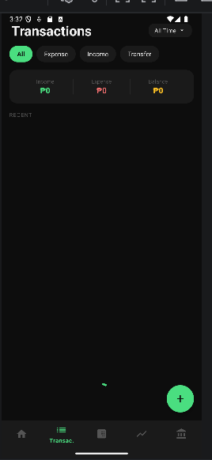

# LeKwarta

**Your money, your court.** LeKwarta is an Android personal finance app built in Kotlin. The name mixes LeBron James with *kwarta*, Filipino slang for money.

**[Try the interactive web demo →](https://yowhann321.github.io/MyPersonalWebsite/projects/lekwarta/)**

| Home | Transactions | Calculator | Stocks |
|---|---|---|---|
|  |  |  |  |

> **Status:** unfinished course prototype. The Accounts and More tabs were planned but never completed.

## Features

- **Login and registration** with token-based sessions
- **Dashboard** with a monthly calendar that colors each day by expense, income, or both, plus today's spend, monthly spend, and total balance
- **Transactions:** log expenses by category, income, or transfers between accounts; filter by type and date; view details or delete
- **Interest calculator:** simple interest, compound interest (monthly compounding), and loan amortization
- **Stocks:** market overview and personal watchlist with live quotes from [Finnhub](https://finnhub.io), ticker search, and auto-refresh every 60 seconds

## Tech stack

- Kotlin, XML layouts, Material Components (min SDK 24, target SDK 36)
- Single activity with fragments and the Navigation component
- OkHttp for networking
- PHP + MySQL REST API running on XAMPP (not included in this repository)

## Running it

1. Open the project in Android Studio.
2. Add your Finnhub API key to `local.properties` (this file is not committed):
   ```
   finnhub.apiKey=YOUR_KEY_HERE
   ```
3. The app expects the PHP API at `http://10.0.2.2:8000/lekwarta/api` (the emulator's address for your PC). Change `BASE_URL` in `ApiClient.kt` if yours is different.

## Team

Ric Bryan Masagca, Paul Jazzmir Entena, Kurt Tracy Amador, and Johann Lijauco.
