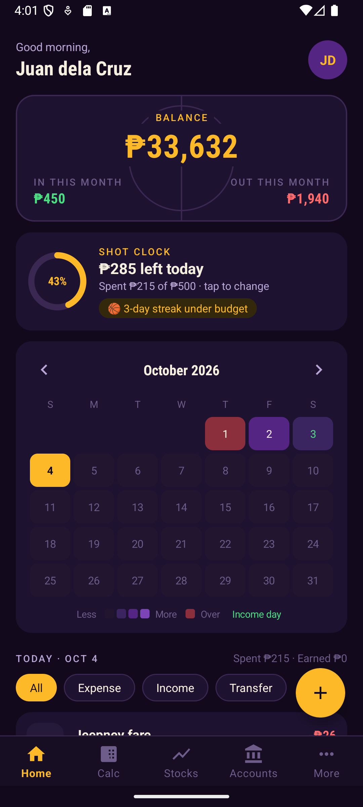
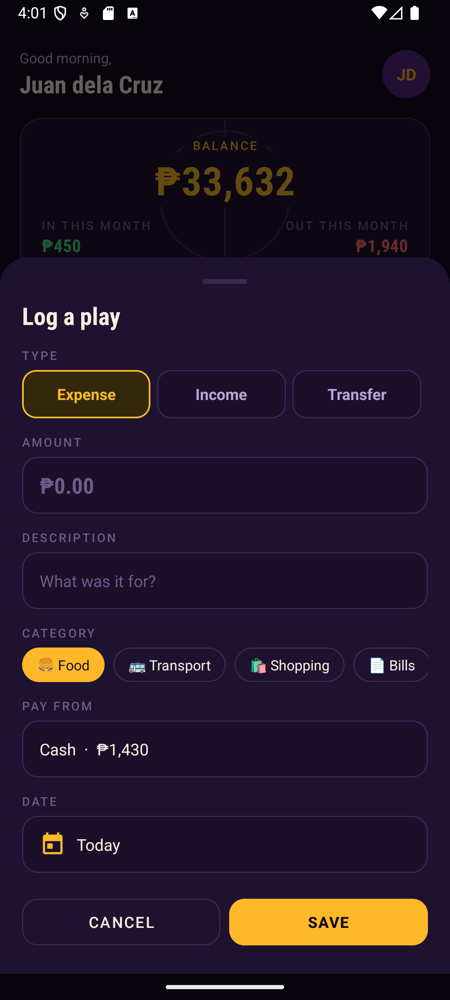
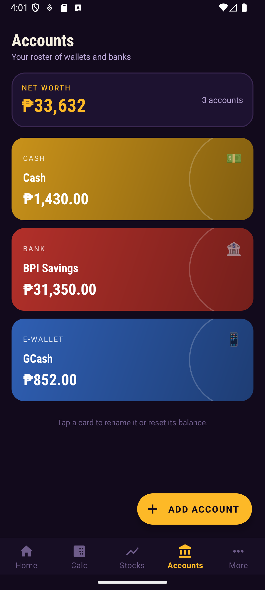
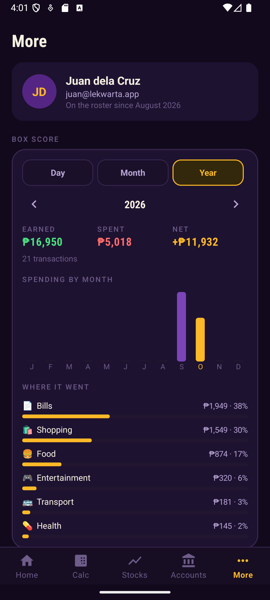
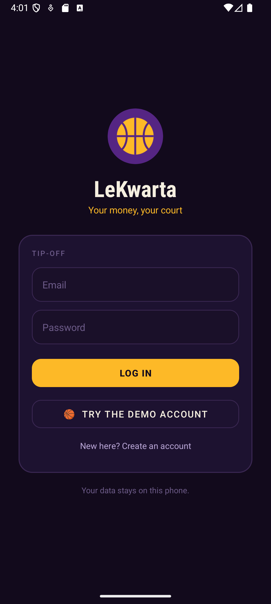
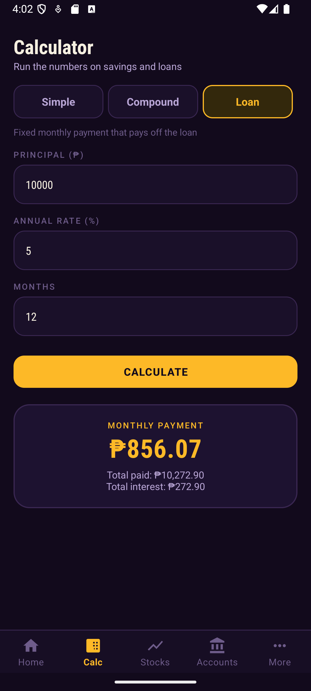
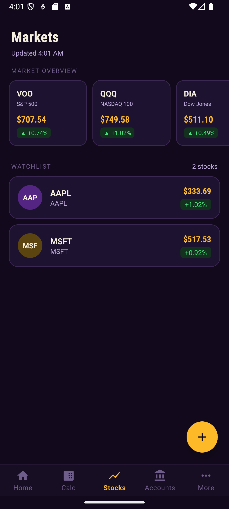
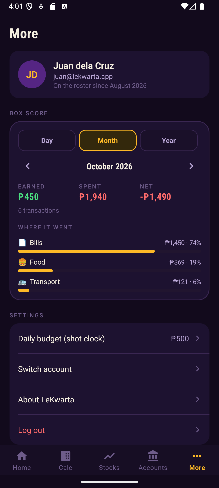

# LeKwarta

**Your money, your court.** LeKwarta is an Android personal finance app built in Kotlin. The name mixes LeBron James with *kwarta*, Filipino slang for money, and the whole app is styled like a basketball arena: Lakers purple and gold, a scoreboard balance, and a "shot clock" daily budget.

**[Try the interactive web demo →](https://yowhann321.github.io/MyPersonalWebsite/projects/lekwarta/)**

| Home | Log a transaction | Accounts | Box score |
|---|---|---|---|
|  |  |  |  |

| Login | Calculator | Stocks | More |
|---|---|---|---|
|  |  |  |  |

## Features

- **Home dashboard**
  - Scoreboard with your total balance plus money in and out this month
  - **Shot clock:** a ring showing how much of today's budget you've used, turning red when you go over, plus a streak counter for days under budget
  - **Heatmap calendar:** each day is shaded by how much you spent relative to your budget; green dates had income, red cells went over budget. Tap any day to see its transactions.
  - Log expenses (by category), income, or transfers between accounts for any past date
- **Accounts:** add wallets and banks (cash, bank, or e-wallet) as color-coded cards, rename them, reset a balance, or delete one. Every transaction deducts from or adds to an account.
- **Calculator:** simple interest, compound interest (monthly compounding), and loan amortization
- **Stocks:** market overview and a watchlist with live quotes from [Finnhub](https://finnhub.io), ticker search, and auto-refresh every 60 seconds
- **More**
  - **Box score:** earned, spent, and net for any day, month, or year, with spending by category and a month-by-month chart for the year
  - Daily budget setting, switch account, and log out
- **Accounts and login:** sign up and log in with passwords hashed using PBKDF2. A demo account with sample data is one tap away on the login screen.

## Tech stack

- Kotlin, XML layouts, Material Components (min SDK 24, target SDK 36)
- Single activity with fragments, the Navigation component, and a bottom navigation bar
- SQLite (`SQLiteOpenHelper`) for users, accounts, and transactions, all stored on the device; balance updates run inside database transactions
- OkHttp for Finnhub market data
- Custom views: the shot clock ring is drawn on a `Canvas`

The first prototype talked to a PHP + MySQL backend on XAMPP. It now stores everything on the phone, so it runs anywhere without a server.

## Running it

1. Open the project in Android Studio and run it on an emulator or phone.
2. For live stock prices, add a free Finnhub API key to `local.properties` (this file is not committed):
   ```
   finnhub.apiKey=YOUR_KEY_HERE
   ```
3. Tap **Try the demo account** on the login screen to explore with sample data, or create your own account.

## Team

Ric Bryan Masagca, Paul Jazzmir Entena, Kurt Tracy Amador, and Johann Lijauco.
